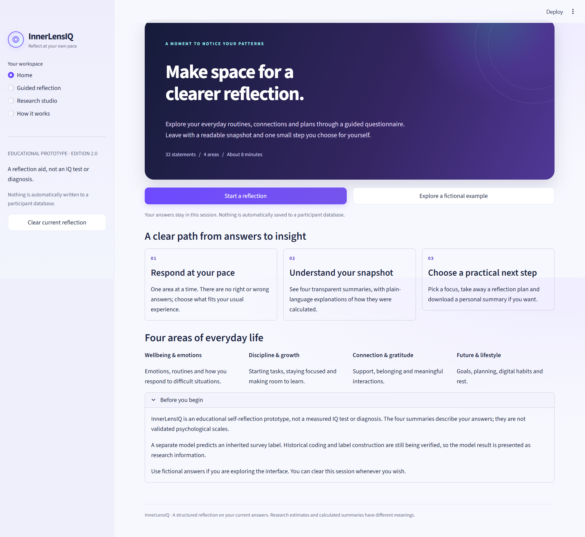
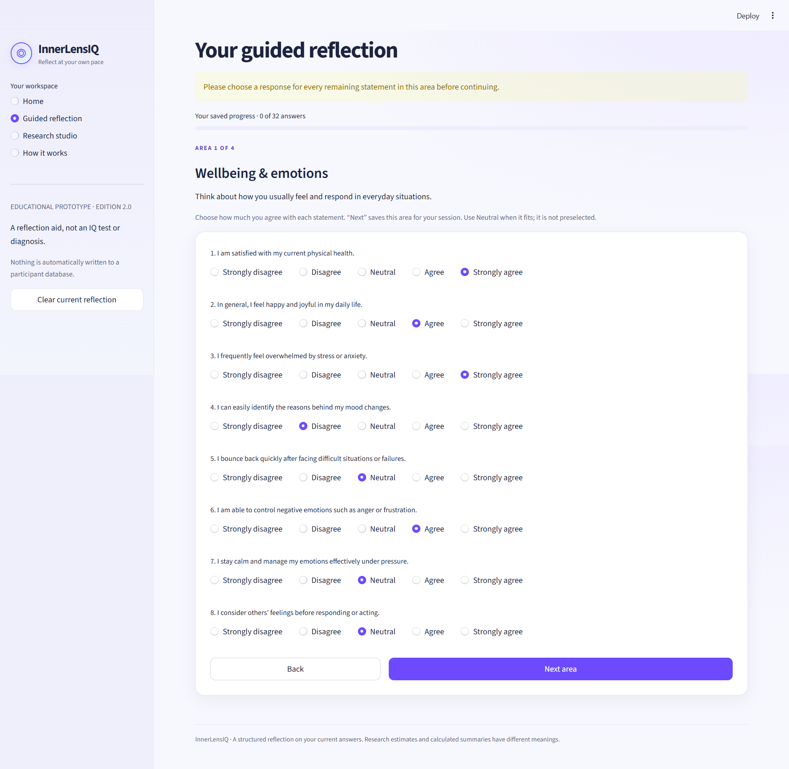
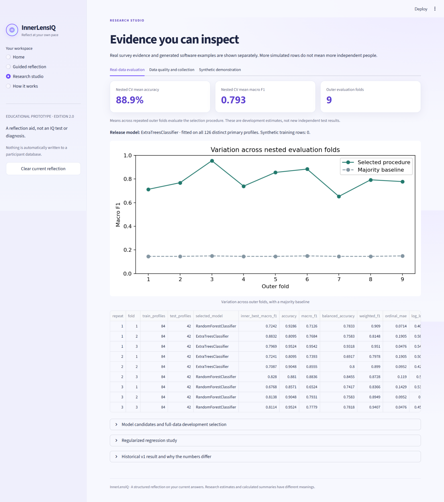
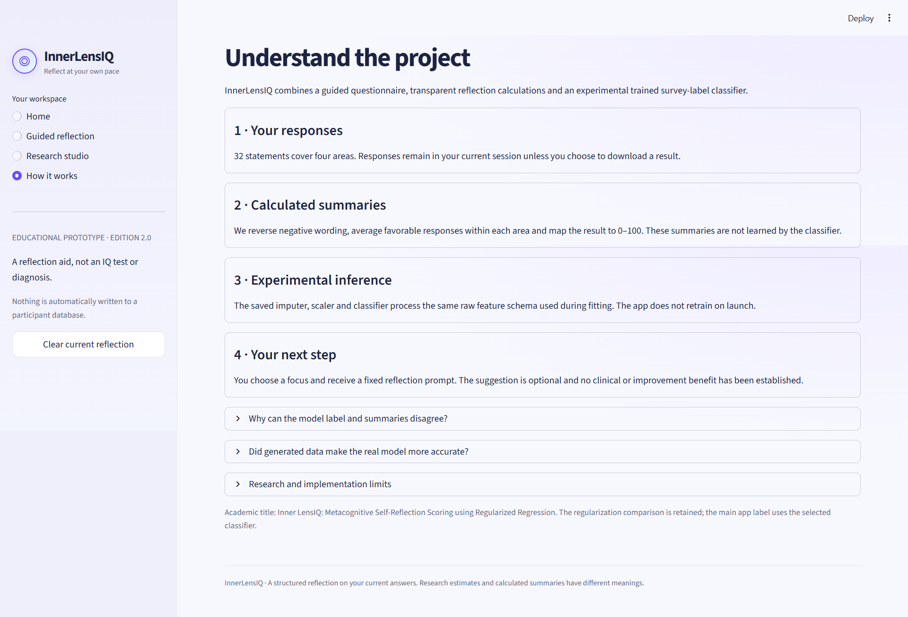
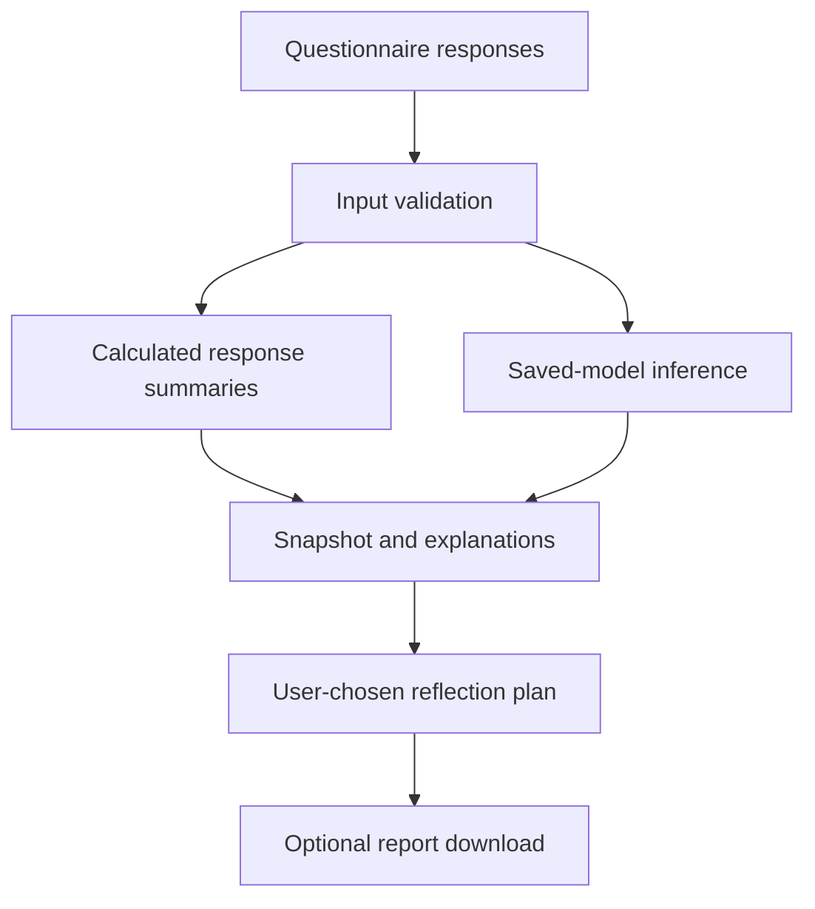

# InnerLensIQ

### Inner LensIQ: Metacognitive Self-Reflection Scoring using Regularized Regression

**A guided self-reflection application that turns questionnaire responses into understandable summaries, experimental insights and practical reflection prompts.**

Python · Streamlit · Scikit-learn · Pandas · NumPy · Altair

MCA Final-Year Team Project · Public Project Showcase

---

[Overview](#overview) · [Application experience](#application-experience) · [Demo and screenshots](#demo-and-screenshots) · [Technology](#technology-stack) · [Evaluation](#evaluation-and-results) · [Source availability](#source-availability)

## Overview

InnerLensIQ helps users pause, review everyday patterns and understand their own questionnaire responses through a guided interface. It combines a structured survey, visual response summaries, a separately presented experimental machine-learning result and a user-chosen reflection plan.

The project brings together data analysis, reproducible machine-learning workflows and an interactive Python application. Its emphasis is on making the experience understandable: users can see what they are answering, how to interpret the outputs and what they can take away from the session.

**This repository is the public showcase for the project. The complete implementation is maintained privately.**

> InnerLensIQ is an educational self-reflection prototype. Its outputs are not clinical diagnoses, measured intelligence or validated psychological assessments. “IQ” is part of the project branding.

## Problem statement

People may notice challenges with routines, focus, relationships or future planning without having a structured way to reflect on them. A questionnaire alone can produce answers without helping the respondent understand the overall pattern.

InnerLensIQ addresses this gap through an accessible application that guides users through their responses, presents readable summaries and helps them choose a small reflection activity. A separate research view makes the experimental nature of its machine-learning component visible.

The objective is to support reflection and explain the system's outputs clearly. The project does not establish treatment benefits or predict the effect of changing a person's behaviour.

## Application experience

| Stage | What the user can do |
| --- | --- |
| **Discover** | Read the introduction or explore a clearly labeled fictional example. |
| **Respond** | Complete 32 statements across four areas, with progress tracking and Back/Next navigation. |
| **Review** | Check responses, edit an area and acknowledge the interpretation before submitting. |
| **Understand** | View visual summaries and explanations, with the experimental model output shown separately. |
| **Explore** | Change a hypothetical answer and compare outputs while retaining the submitted snapshot. |
| **Reflect** | Choose an area of focus and receive a practical reflection prompt. |
| **Take away** | Download a readable HTML summary or structured JSON report. |

The four areas cover wellbeing and emotions, discipline and growth, connection and gratitude, and future and lifestyle habits.

## Demo and screenshots

The demonstration follows the user journey from the landing page to questionnaire completion, result interpretation and report download. Fictional responses are used for demonstration so that participant records are not exposed.

https://github.com/user-attachments/assets/e60217ee-309f-46cf-985b-ceaf8d65db15

### Landing page

A concise introduction, clear entry points and an optional fictional demonstration help users understand where to begin.

### Guided questionnaire & Reflection snapshot

The questionnaire presents one area at a time. Answers begin unselected, progress is visible and missing responses are checked before continuing.

### Research studio

The research view separates real-data evaluation from synthetic demonstrations and explains the limits of the available evidence.

### Working

## Result

## Key features

- **Guided interaction:** four questionnaire areas, saved session progress, response review and input validation.
- **Readable results:** visual response summaries, plain-language explanations and explicit handling of equal scores.
- **Actual saved-model inference:** the application loads trained artifacts and uses the same feature schema as its training workflow.
- **Alternative-answer exploration:** hypothetical changes update calculations and model output without overwriting the original snapshot.
- **User-chosen reflection plans:** users select a focus and receive a fixed reflection prompt and check-in activity.
- **Report downloads:** offline HTML and JSON exports; individual answers are excluded unless the user chooses to include them.
- **Session comparisons:** users can voluntarily keep up to five snapshots in the current session.
- **Research transparency:** evaluation results, data-quality context and a clearly isolated synthetic-data teaching lab.
- **Responsive presentation:** a violet, midnight-blue and cyan theme, subtle hover effects and animations that respect reduced-motion settings.

## High-level workflow

The calculated summaries and experimental model prediction are different outputs. The summaries describe the submitted responses; the model predicts an inherited survey category. The application explains this distinction rather than presenting the two as interchangeable measurements.

Regularized regression remains part of the comparative research study reflected in the academic project title. A separate classification component produces the application's experimental category output. Implementation details and internal scoring specifications are maintained privately.

## Technology stack

| Technology | Role in the implementation |
| --- | --- |
| **Python 3.12** | Application logic and data-science workflow |
| **Streamlit** | Interactive forms, navigation, results and downloads |
| **Pandas and NumPy** | Data preparation and numerical operations |
| **Scikit-learn** | Preprocessing pipelines, model selection and evaluation |
| **Joblib** | Saving and loading trained artifacts |
| **Altair, Matplotlib and Seaborn** | Interactive charts and research visualizations |
| **Jupyter / IPython** | Sequential analysis and research notebooks |
| **Pytest and Streamlit AppTest** | Automated validation and application-flow checks |
| **Playwright / Chromium** | Browser interaction and responsive checks |
| **HTML and CSS** | Local styling, animation and readable report presentation |

The complete application includes pinned dependencies and Windows setup and launch scripts. Normal use loads the supplied trained artifacts without retraining or requiring the private survey CSV.

## Data and research scope

The supplied primary survey export contains **800 records**. Data-quality work included missing-value checks, duplicate-response checks, feature validation and examination of response distributions. Repeated response profiles were addressed before modelling; the export row count should not be interpreted as a verified count of independent participants.

Participant-level survey records are not distributed through this public showcase. The application also avoids automatically writing users' questionnaire answers to a participant database.

A separate teaching lab contains **3,000 explicitly fictional response profiles**. These examples have their own model and evaluation. They do not enter the primary model's training or real-data evaluation, and they do not represent additional human participants.

## Evaluation and results

The primary model-selection procedure was evaluated using **repeated nested cross-validation**. Candidate selection and tuning took place within each outer training partition, before evaluation on the corresponding outer evaluation partition.

| Primary-data measure | Mean across nine outer evaluations |
| --- | ---: |
| **Accuracy** | **88.89%** |
| **Macro F1-score** | **0.7930** |
| **Balanced accuracy** | **78.80%** |

Macro F1 and balanced accuracy help assess performance across categories when their frequencies differ.

These are development resampling estimates of the selection procedure. The folds reuse the same dataset; they are not nine independent participant cohorts or a new external validation study. The final inference artifact was subsequently refitted on the available cleaned profiles and has no new independent test score. The reported numbers do not establish psychological validity or prove an improvement over an earlier evaluation performed with a different split.

## Verification

| Check | Executed evidence |
| --- | --- |
| **Automated tests** | 31 tests passed, including a run after extracting the release ZIP. |
| **Saved-model loading** | Reloaded artifacts produced actual predictions without the private CSV. |
| **Guided application flow** | Questionnaire completion, review, acknowledgement and model inference exercised. |
| **Browser checks** | Home, questionnaire, results, research views and readable download exercised in Chromium. |
| **Responsive checks** | Desktop and mobile viewport checks completed. |
| **Animation behaviour** | Hover states and reduced-motion disabling checked. |
| **Research notebooks** | Eight notebooks executed using an in-process IPython runner in the build environment. |

Automated and browser checks were performed in a Linux build environment. They cover the recorded scenarios and do not constitute exhaustive cross-browser, accessibility, security or production-load certification.

## Privacy and interpretation

- Questionnaire responses remain in the current application session unless a user explicitly downloads a report. The application does not automatically save them to a participant database.
- Optional session snapshots are temporary and are not a longitudinal psychological assessment.
- Summaries describe responses; they are not population percentiles or validated trait measurements.
- Experimental model scores are uncalibrated and should not be interpreted as clinical probabilities.
- Historical scale coding and target-label construction remain research limitations requiring verification.
- Hypothetical answer comparisons do not establish causation or predict real-life improvement.
- Public screenshots and recordings should use fictional demonstration responses.

## Project context

InnerLensIQ is an **MCA final-year project developed by a four-member student team**. It combines data understanding, modelling, application integration, testing and technical documentation in one working system.

The project demonstrates a complete path from survey-data preparation and reproducible experiments to saved-model inference and a usable interface. Detailed technical explanations and internal study materials are maintained with the private implementation.

## Future scope

Further research could include collecting a larger independent, consented dataset; verifying the response scale and labeling protocol; performing external validation; and conducting structured usability and accessibility studies. Any expanded interpretation would require evidence appropriate to the claim.

## Source availability

This repository presents the project's public overview and demonstration materials. The complete application source, trained artifacts, participant data and internal implementation notebooks are not distributed here.

Cloning this showcase repository does not install or run the complete application. Its purpose is to communicate the implemented experience and research scope while keeping the implementation private.

---

**InnerLensIQ — a structured reflection on your current answers.**
